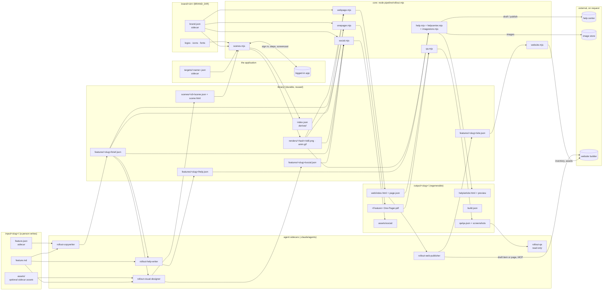

# Architecture: sidecars around a brand-agnostic core

Rollout turns a plain-English feature description into a branded one-pager
PDF, a matching web page and a social pack, and — on request — the
help-center article and the feature page on the website. It is built on the
**sidecar pattern**, used at two levels:

1. **Data sidecars.** Every primary artifact has a machine-readable JSON file
   beside it that carries everything about it that varies: the brand, the
   feature, each visual, each build. The core never contains a brand name, a
   colour or a product fact; attach a different sidecar and the same core
   produces a different company's rollout.
2. **Agent sidecars.** The deterministic core (`pipeline/`) never writes copy
   or invents visuals. Agents run beside it and do only the judgement work —
   writing, designing, reviewing — and their only output is sidecars the core
   reads. So any build can be reproduced from the sidecars alone, with no
   model in the loop, and an agent can be swapped or re-run without touching
   the renderer.

## The sidecars

| Sidecar | Beside | Written by | Read by | Carries |
|---|---|---|---|---|
| `brand/<id>/brand.json` | logos, icons, fonts | a person, once per brand | every stage | name, contact, social, nav, colours, fonts, voice, rules |
| `.env` | the repo | a person, per deployment | `env.mjs` | which brand, `BRAND_*` overrides, CTA defaults, folders, render settings, target credentials, the help center, image store and website connections |
| `targets/<name>.json` | `profiles/<name>/` | a person, once per app | `target.mjs`, `capture.mjs` | app URL, sign-in, viewport, hide/blur/block, secrets (as `env:` refs) |
| `input/<slug>/feature.json` | `feature.md`, `assets/` | a person (from the template) | agents, `brief.mjs` | name, status, audience, section count, overrides, asset list |
| `library/features/<slug>/brief.json` | the feature's scenes | copywriter agent | `onepager.mjs`, `webpage.mjs` | all copy, which scene illustrates what |
| `library/scenes/<id>/scene.json` | (`scene.html` for kit scenes) | visual-designer agent | `scenes.mjs`, `capture.mjs` | capture: target, start, setup, steps, clip · kit: size, animation · both: still moment, tags |
| `library/renders/<hash>/render.json` | `still.png`, `anim.gif`, `web.gif` (captures) | `scenes.mjs` | `library.mjs` | which scene, which brand, settings, when |
| `library/features/<slug>/social.json` | the feature's scenes | visual-designer agent | `social.mjs` | the social pack: slide title accents, crops ([social.md](social.md)) |
| `library/features/<slug>/help.json` | the feature's scenes | help-writer agent | `help.mjs`, `helpcenter.mjs` | the help article as blocks; which live article it updates ([help.md](help.md)) |
| `library/features/<slug>/help.published.json` | help.json | `helpcenter.mjs` | `help.mjs`, the help-writer agent | the article in the help center: id, URL, state, when it last changed |
| `library/features/<slug>/site.json` | `output/<slug>/web/page.json` | web-publisher agent | `website.mjs`, the web-publisher agent | the feature page: an item of the site's feature CMS collection (fields by slug), or site components in order with prop values and components to create ([website.md](website.md)) |
| `library/features/<slug>/site.published.json` | site.json | `website.mjs` | the web-publisher agent | the page or CMS item in the website: id, path, URL, draft, when it last changed; uploaded image assets by hash |
| `output/<slug>/build.json` | the PDF and web folder | `rollout.mjs build` | QA, people | brand and exact render hashes used |
| `output/<slug>/web/page.json` | `index.html` | `webpage.mjs` | the web-publisher agent, a CMS import | the page as structured content |
| `output/<slug>/qa/qa.json` | screenshots | `qa.mjs` | QA agent | measured verdict and findings |

## Why each boundary is where it is

- **Brand outside the code.** `brand.mjs` is the only reader of
  `brand.json`; it turns it into CSS custom properties and inline SVG marks.
  Scenes and templates use only `var(--primary)` and friends, so one scene
  renders in every brand. `.env` overrides (`BRAND_PHONE`, `BRAND_COLOR_*`)
  let one brand folder serve several deployments.
- **Copy separate from layout.** The brief is the single source both outputs
  are built from, so the PDF and the page cannot disagree. Its length limits
  (`brief.mjs` `LIMITS`) are the PDF's physical limits, enforced before
  rendering.
- **Visuals from the product.** A capture scene is a sidecar of steps
  against the real application: `capture.mjs` signs in through the target
  (form login off camera, or a persistent SSO profile), reaches the state,
  and records the feature with a screencast and an injected cursor. The
  scene names *what* to show; the target says *where* and *how to sign in*,
  so the same scenes re-capture against another environment by switching
  targets, and no credential is ever in a scene. Captures are hashed on the
  scene, the target's look and the capture engine — never the brand — so a
  brand switch reuses them.
- **Kit scenes for what cannot be captured.** A kit scene is HTML from a fixed kit
  (`pipeline/kit/kit.css`) plus a step list. The runtime (`kit/runtime.js`)
  rebuilds the scene for any time `t`, so stills and every GIF frame are
  exact and reproducible. Used for the hero composition (embedding a capture
  with `scene:<id>`) and coming-soon UI.
- **A library, not a cache folder.** Briefs and scenes are authored work and
  are kept permanently in `library/`. Renders are content-addressed (scene +
  its local files + brand look + kit + settings), so unchanged scenes are
  never re-rendered and a new brand gets its own renders beside the old ones.
  `index.json` is derived from the folders on every write and powers
  `library search`, which agents use before drawing anything new.
- **Output is disposable.** Everything in `output/` can be rebuilt from
  `input/` + `library/` + the brand with one command; it is gitignored.

## Flow

1. A person writes `input/<slug>/feature.md` (+ optional assets).
2. `rollout-copywriter` → `brief.json` (checks `validate`).
3. `rollout-visual-designer` → probes the signed-in app, writes capture
   scenes, records and inspects them (`scene <id>`), and writes
   `social.json`; data-changing steps wait for the user's approval.
4. `rollout.mjs build` → renders missing scenes, prints the PDF, writes the
   web folder, the social pack and the help article, records `build.json`.
5. `rollout.mjs qa` + `rollout-qa` → PASS/FAIL on the PDF and the served web
   page, with fixes; the user approves fixes, which go back to the owning agent.
6. `rollout-help-writer` → finds the help-center article that covers the
   feature (`help-find`, `help-get`), writes `help.json`, `rollout.mjs help`
   renders it; on the user's approval `rollout.mjs help-publish` uploads new
   images to the image store and creates or updates the article over the help
   center's API — a draft unless the user says publish.
7. `rollout-web-publisher` → reads the site (`site-find`): with a feature CMS
   collection, plans the page as an item there; otherwise plans it from the
   site's components. Writes `site.json` (`site-plan`); on the user's approval
   uploads its images (`site-assets`), creates the draft item — or the draft
   page and any missing component, for reuse — through the site builder's MCP
   server, and records it (`site-record`). Publishing is the user's.
8. `rollout.mjs serve <slug> --open` → the page on a local server, shown in
   the browser to confirm it renders.

C4 diagrams of the same architecture (context, containers, pipeline
components, one rollout as a sequence) are in [`c4/`](c4/README.md).

## Code map

| File | Role |
|---|---|
| `pipeline/env.mjs` | `.env` loading, folders, per-feature paths |
| `pipeline/brand.mjs` | brand sidecar → colours, fonts, marks, CSS |
| `pipeline/brief.mjs` | feature input, brief defaults, validation limits |
| `pipeline/library.mjs` | scenes, render hashes, derived index, search, fork |
| `pipeline/scenes.mjs` | scene → still PNG + GIF: dispatches captures, renders kit scenes, resolves `scene:` embeds |
| `pipeline/target.mjs` | target sidecars, `env:` references, secrets |
| `pipeline/capture.mjs` | sign-in, steps, screencast, clip, GIF encoding; `probe`, `login` |
| `pipeline/kit/` | scene kit CSS and seekable runtime |
| `pipeline/onepager.mjs` | brief → paginated HTML → PDF |
| `pipeline/webpage.mjs` | brief + brand `web` block → the site's feature-page layout + page.json |
| `pipeline/webmedia.mjs` | the web cut format: framed 1180×676 GIFs (from capture frames, or fitted); the framed help-article images |
| `pipeline/social.mjs` | social.json + brief + renders → the social pack (cover, carousel, thumbnails, email and signature images) |
| `pipeline/help.mjs` | help.json + brand `help` block → the help article's HTML body, preview and images |
| `pipeline/helpcenter.mjs` | find, read, create and update help articles over the help center's API (adapters in `helpcenter/`); the publish guards |
| `pipeline/website.mjs` | the website: reads its pages, components and feature CMS collection, checks site.json, uploads the page's images, records the built page or item (adapters in `website/`: `webflow`) |
| `pipeline/imagestore.mjs` | uploads the help article's new images where the help center can copy them, while publishing (adapters in `imagestore/`: `s3`) |
| `pipeline/qa.mjs` | measured checks + screenshots (web page loaded through `serve.mjs`) |
| `pipeline/serve.mjs` | static server for a built web folder: QA and `rollout.mjs serve` |
| `pipeline/chrome.mjs` | headless Chrome (puppeteer-core) |
| `pipeline/rollout.mjs` | CLI for all of the above |
